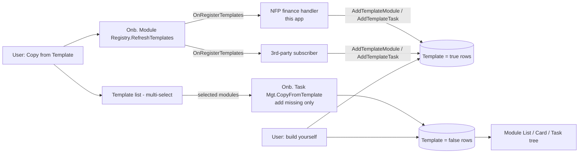

# Architecture: Onboarding Framework (POC)

**Date**: 2026-11-22
**Revision**: 3 (approved by the user in session on 2026-11-22). Install starts blank, a Template flag marks template modules, Copy from Template, users can build content themselves, and there is one permission set. Revision history: rev 1 (flat tasks) was approved; rev 2 (nested tasks) was approved; rev 3 approved.
**Complexity**: MEDIUM
**Author**: al-architect
**Status**: Approved

> **Skills applied**: skill-events, skill-pages, skill-permissions
> **BCQuality**: not consulted (BCQuality plugin not installed)

---

## 1. Executive Summary

This is a per-company onboarding framework, installed in each new customer's Business Central tenant (the customer is a not-for-profit organisation). It **starts blank**. A consultant either **copies modules from templates** or **builds modules and tasks themselves**. Modules contain nested tasks of type Read or Test, which users work through and mark complete. Templates are ordinary modules with a **Template** flag. The app ships an NFP finance template set with Microsoft Learn links. Third-party extensions contribute their own template modules through an integration event.

## 2. Business Context

### Problem Statement

New-customer onboarding currently has no structured, in-product record showing which finance areas have been read up on, tested and signed off. Partners need a repeatable starting point (templates), and they also need to tailor or hand-build the content for each customer.

### Success Criteria

| ID | Criterion | Observable |
|----|-----------|------------|
| AC-01 | Install creates no modules. The standard NFP finance templates are available for copying | After install the module list is empty. Copy from Template lists the 9 NFP finance template modules, each with Learn links |
| AC-02 | Users can open the Microsoft Learn link for a module or task | Open Learn opens the link, using the task's link and falling back to the module's |
| AC-03 | Users can set a task's status. Completion records who and when | Status Completed stamps Completed By and Completed At. Reopening clears both |
| AC-04 | Module progress is visible | Leaf-only counts and Progress % on the module list |
| AC-05 | Another extension can add template modules without changing this app | A sample extension subscribed to `OnRegisterTemplates` shows up in the template list |
| AC-06 | Copying never loses progress or manual edits | Copying into an existing live module adds only the missing tasks. Refreshing templates never touches live modules |
| AC-07 | Tasks nest to 10 levels and show as a tree. Group status is rolled up from the tasks below it | As in revision 2 |
| AC-08 | Users can build modules and nested tasks themselves | Create a module and tasks on the pages, choose a Parent Task, and the tree updates |
| AC-09 | Users can create their own templates | A new module with Template ticked appears in the template list and can be copied |

## 3. Solution Architecture

There are two tables, `Onb. Module` and `Onb. Task`. Both carry `Template` (Boolean) as the first primary-key field, so a template module and a live module can share a code. The code-provided templates are written by `Onb. Module Registry`. It raises `OnRegisterTemplates`, and subscribers call idempotent `AddTemplateModule` / `AddTemplateTask` procedures. This app's own handler is the first provider (NFP finance). `Copy from Template` refreshes the templates first, then shows them for multi-selection, and finally copies the selected ones into live modules, adding only what's missing.

## 4. Data Model

| Object | Type | Purpose | Notes |
|--------|------|---------|-------|
| 80000 `Onb. Module` | Table | Live modules and template modules | PK (`Template`, `Code`). Template is set when the record is created and is not editable afterwards. Fields: Description, Sequence, Source App ID and Name (blank for user-built modules), Learn URL. FlowFields count leaf tasks (Is Group = false) |
| 80001 `Onb. Task` | Table | Nested tasks | PK (`Template`, `Module Code`, `Task Code`). Fields as in revision 2: Parent Task Code, Indentation, Is Group, Sort Path, Status, stamps, Notes. Hierarchy upkeep now runs from **table validation**, so user edits and the registry follow the same rules |
| 80000 / 80001 | Enums | Task Type, Task Status | Unchanged |

## 5. Business Logic

| Procedure | Visibility | Responsibility |
|-----------|-----------|----------------|
| `Onb. Module Registry.RefreshTemplates()` | Public | Raises `OnRegisterTemplates` |
| `Onb. Module Registry.AddTemplateModule(...)` / `AddTemplateTask(...)` | Public | Idempotent upsert of **template** rows only, with an ownership check through `GetCallerModuleInfo` |
| `Onb. Module Registry.OnRegisterTemplates(var Registry)` | IntegrationEvent | The third-party extension point |
| `Onb. Task Mgt.CopyFromTemplate(var TemplateModule)` | Public | For each selected template module: create the live module if it's missing, then add the missing tasks, parents before children. New tasks start Not Started with no notes or stamps |
| `Onb. Task Mgt.UpdateHierarchy(var Task)` | Public | Applies the cycle and depth checks, then recalculates Indentation, Sort Path (the task and its descendants) and the parents' Is Group flags |
| `Onb. Task Mgt.GetRollupStatus` / `CompleteBranch` / `OpenLearn` | Public | As in revision 2 |

## 6. User Interface

- **80000 Onb. Module List**: live modules only (Template = false), editable with New and Delete. Actions: Copy from Template, Open Learn.
- **80003 Onb. Template List** (new): template modules only. Actions: Refresh Templates. It is also opened in lookup mode for multi-select by Copy from Template.
- **80001 Onb. Module Card**: serves both live and template modules. Editable for user-built modules. Provider templates (Source App ID set) are read-only.
- **80002 Onb. Task Part**: a tree with New and Delete enabled. Parent Task Code can be looked up within the same module. Status and Notes are hidden on template rows.

## 7. Integration Points

- **Published (new)**: `OnRegisterTemplates`. It replaces revision 2's `OnRegisterModules`; nothing has been released yet, so this breaks nothing.
- **Subscribed (own)**: the NFP finance handler.
- **Standard BC events**: none.
- **External**: Learn links are opened client-side with `Hyperlink()`.

## 8. Security Model

| Object | DataClassification | Permission |
|--------|-------------------|------------|
| Onb. Module, Onb. Task | CustomerContent. Completed By = EndUserIdentifiableInformation | `ONB ALL` RIMD (single set, user decision) |

Business rules are validated in the tables: https-only links, hierarchy rules, group status, and the read-only status of provider templates.

## 9. Performance Considerations

Volume is tiny, a few hundred rows. Copying runs one Get per task. Nothing further is needed.

## 10. Technical Decisions

### TD-01: Extensibility via integration event, now for templates (revised)
- **Decision**: `OnRegisterTemplates` with the `AddTemplateModule` / `AddTemplateTask` procedures. Providers only ever write template rows. Live data belongs to the customer.
- **Rationale**: Install starts blank, and providers have no business creating live content.

### TD-02: Shared, per-company status (unchanged)

### TD-03: Custom tables, not Guided Experience (unchanged)

### TD-04: Stable Task Code (unchanged). Copying keeps the template's Task Codes, which is what makes "add missing only" possible.

### TD-05: Standard content hard-coded in the handler codeunit (unchanged). The content is the NFP finance set, defined in the spec §4a.

### TD-06: Nested tasks use a parent pointer and calculated group status (unchanged). Hierarchy upkeep moves into table validation (Task Mgt.UpdateHierarchy).

### TD-07: Templates are flagged modules in the same tables (user decision)
- **Problem**: Templates need to exist alongside live modules.
- **Decision**: A `Template` Boolean is the first primary-key field on both tables, so templates and live modules can share a code. It can't be changed after the record is created.
- **Alternatives rejected**: separate template tables (more objects); templates held only in memory (users couldn't build their own); a non-key flag (the codes would clash on copy).
- **Rationale**: This was the user's choice. It gives one set of pages and one hierarchy logic for both kinds.

### TD-08: Blank install, copy on demand, add missing only (user decision)
- **Decision**: There is no auto-seeding. Copy from Template refreshes templates, then the user multi-selects modules to copy. An existing live module gets only the tasks it's missing.
- **Rationale**: Protects progress and manual edits, and lets a template be re-copied safely after it grows.

### TD-09: One permission set (user decision)
- **Decision**: `ONB ALL` (RIMD on both tables). The ONB VIEW set is dropped.
- **Rationale**: This is a POC, and the user chose it. Splitting into Admin and User sets can come later.

## 11. Implementation Phases

### Phase 1 — Data and hierarchy
Enums 80000–80001, tables 80000–80001, codeunit 80002 Onb. Task Mgt. **Exit**: tasks entered by hand build a correct tree, and cycle and depth errors fire.

### Phase 2 — Templates
Codeunit 80000 Registry, codeunit 80001 NFP finance handler, CopyFromTemplate. **Exit**: AC-01, AC-05, AC-06, AC-09.

### Phase 3 — UI and permissions
Pages 80000–80003 and permission set 80000. **Exit**: AC-02, AC-03, AC-04, AC-07 and AC-08 pass when checked by hand.

## 12. Risks & Mitigations

| ID | Risk | Likelihood | Impact | Mitigation |
|----|------|-----------|--------|------------|
| R-01 | Learn URLs move | Medium | Low | The links are editable, verified on 2026-11-22 |
| R-02 | Two providers use the same template module code | Low | Medium | An ownership check through Source App ID, plus a publisher prefix by convention |
| R-03 | `GetCallerModuleInfo` resolves to the wrong app | Medium | Low | Called directly in the public procedure. Checked by hand with a sample extension |
| R-05 | Hierarchy cycle or nesting too deep | Medium | Low | Checked in table validation |
| R-07 | A user edits a provider template, and the next refresh overwrites the edit | Medium | Low | Provider templates are read-only in the UI. Users copy the template to a module of their own (or a user-built template) to customise it |
| R-08 | The Template flag is set wrongly on a new module | Low | Low | The flag can't be edited after creation. Delete the module and create it again |
| R-04 | No automated tests (user decision) | High | Medium | Manual sandbox checks, reported as not run |

## 13. Deployment Plan

- **Pre-deploy**: compile against BC 29 / runtime 18.
- **Post-deploy**: the list is empty. Copy GL and DIM from the template and confirm the trees.
- **Rollback**: uninstalling keeps the data. Copying is idempotent.

## 14. Spec Decomposition

**Single spec** (SPEC-01), at `.claude/plans/onboarding-framework/onboarding-framework.spec.md`. It covers AC-01..AC-09 and TD-01..TD-09. Dependencies: none. ID allocation: 80000–80003 within 80000–80100. Authoring group G1 holds SPEC-01, which is eligible. Joint review: not applicable.
