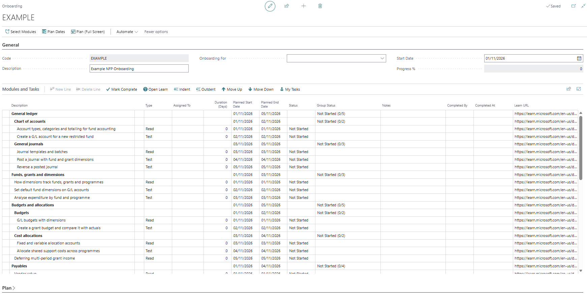
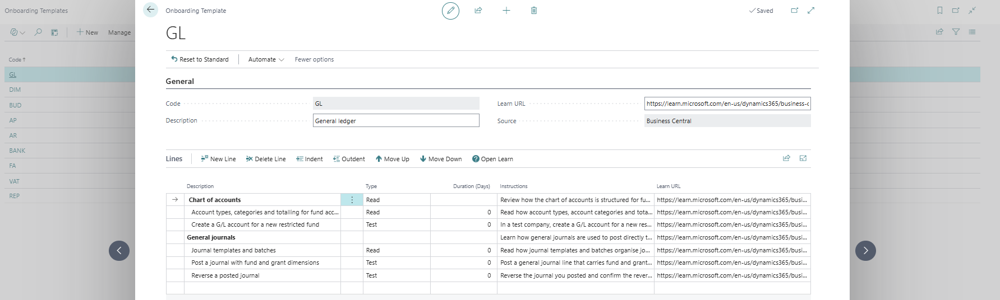
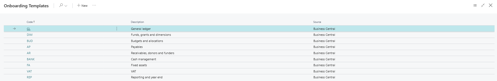
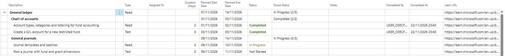
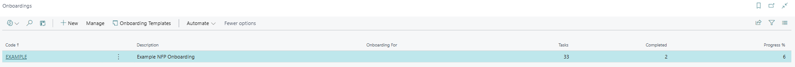
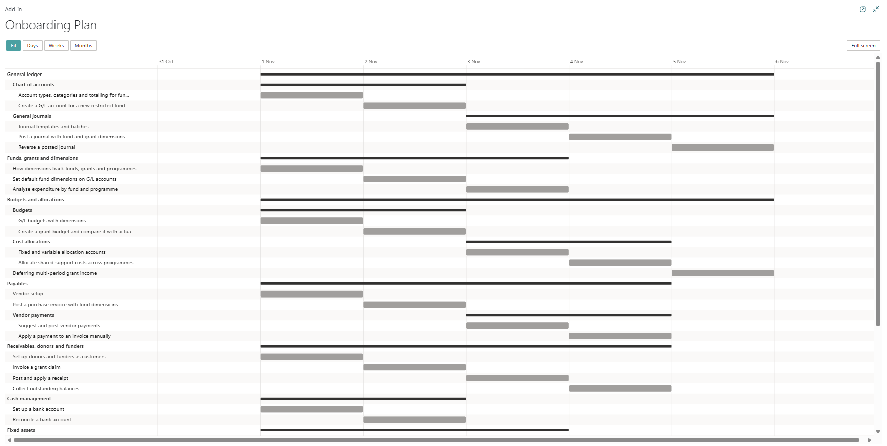

# BC Onboarding

A Business Central extension for planning and tracking customer onboarding. You build onboardings from reusable templates. Each onboarding is a list of modules and tasks that people work through, tick off and plan on a Gantt chart.

It ships with a set of templates for the finance side of Business Central, aimed at not-for-profit organisations. Each template links to the relevant Microsoft Learn articles.



## Features

- **Onboardings.** Create an onboarding per customer, per person or per team. Choose **Select Modules** to add templates, then work through the tasks. You can add, remove and reorder tasks freely.
- **Templates.** Reusable modules of tasks. You can edit them, add your own, and add customer-specific lines to the standard ones. **Get Standard Templates** only adds templates you don't have yet, so your changes are never overwritten. **Reset to Standard** restores a standard template.
- **Nested tasks.** Lines are indented like Job Tasks. Use **Indent**, **Outdent**, **Move Up** and **Move Down**. A line's sub-tasks always move with it.
- **Progress.**
  - Each task has a status: Not Started, In Progress, Completed or Not Applicable.
  - Completing a task records who completed it and when.
  - Modules and groups show a rolled-up status, for example `In Progress (2/5)`.
  - The onboarding list shows the task count and Progress %.
  - **Mark Complete** on a group completes every open task under it.
- **People.** Use **Onboarding For** to make an onboarding personal. Use **Assigned To** to split work within an onboarding, and **My Tasks** to filter to your own. Assigning a group also assigns the tasks under it.
- **Microsoft Learn links.** Every line can have a Learn URL. **Open Learn** opens it, falling back to the nearest parent line's link and then the template's.
- **Planning.**
  - Tasks have a **Duration (Days)** and planned start and end dates.
  - **Plan Dates** schedules every task from the onboarding's **Start Date**. Modules run side by side, and the tasks inside a module run one after another.
  - Modules and groups show the date span of their tasks.
- **Gantt chart.**
  - The **Plan** section on the onboarding card shows the schedule.
  - Bars are coloured by status, and a dashed line marks today.
  - Zoom with Fit, Days, Weeks or Months.
  - **Plan (Full Screen)** opens the chart on its own full-size page.

## Requirements

- Business Central 2026 release wave 2 (application 29.0) or later, with AL runtime 18.0.
- Object IDs 80000–80100.

## Getting started

1. Clone the repository and open it in VS Code with the AL Language extension.
2. Create `.vscode/launch.json` for your sandbox. It isn't in the repository because it holds environment details.
3. Download symbols, then publish (F5).
4. Assign the **ONB ALL** permission set to users.
5. In Business Central, search for **Onboarding Templates**. The standard templates are created on install. If the list is empty, choose **Get Standard Templates**.

   

## Using it

1. Search for **Onboardings** and choose **New**. Enter a code, a description and, optionally, who the onboarding is for and its start date.
2. Choose **Select Modules** and pick one or more templates. Each template is added as a module with its tasks underneath.

   

3. Add your own tasks with **New Line**, then arrange them with Indent, Outdent, Move Up and Move Down.
4. Set durations, then choose **Plan Dates**, or enter planned dates by hand.
5. Work through the tasks: set Status, add Notes, and assign people.

   

6. Follow progress on the onboarding list, the card and the Gantt chart.

   

   

Running **Select Modules** again for a module that's already on the onboarding only adds the template lines that are missing. It puts each one in its original position and never changes statuses or lines you added.

## Standard templates

| Code | Template |
| --- | --- |
| GL | General ledger |
| DIM | Funds, grants and dimensions |
| BUD | Budgets and allocations |
| AP | Payables |
| AR | Receivables, donors and funders |
| BANK | Cash management |
| FA | Fixed assets |
| VAT | VAT |
| REP | Reporting and year end |

There are 9 templates with 40 lines in total, of type Read or Test, each with instructions and a Microsoft Learn link.

## Adding templates from another extension

Subscribe to `OnRegisterTemplates` and register templates and their lines in display order, with parents before their sub-tasks:

```al
[EventSubscriber(ObjectType::Codeunit, Codeunit::"Onb. Template Registry", 'OnRegisterTemplates', '', false, false)]
local procedure RegisterMyTemplates(var Registry: Codeunit "Onb. Template Registry")
begin
    if not Registry.AddTemplateModule('PAYROLL', 'Payroll', 100, 'https://learn.microsoft.com/...') then
        exit; // the template already exists and belongs to the customer now

    Registry.AddTemplateTask('PAYROLL', '', 'PAY-10', 'Payroll setup', "Onb. Task Type"::Read,
        'Review the payroll setup.', 'https://learn.microsoft.com/...');
    Registry.AddTemplateTask('PAYROLL', 'PAY-10', 'PAY-11', 'Run a test payroll', "Onb. Task Type"::Test,
        'Run payroll for one employee in a test company.', '');
end;
```

- `AddTemplateModule` creates the template only if its code doesn't exist yet. When it returns false, any `AddTemplateTask` calls for that template are ignored.
- A blank parent puts the task at the top level of the template.
- The registry records which extension called it, using `NavApp.GetCallerModuleInfo`. That extension is shown as the template's source and is used by **Reset to Standard**.
- Don't call `Commit` in subscribers.

## Objects

| Type | ID | Name |
| --- | --- | --- |
| Table | 80000 | Onb. Template |
| Table | 80001 | Onb. Onboarding |
| Table | 80002 | Onb. Line (lines for both templates and onboardings) |
| Enum | 80000 / 80001 / 80002 | Onb. Task Type / Onb. Task Status / Onb. Document Type |
| Codeunit | 80000 | Onb. Template Registry |
| Codeunit | 80001 | Onb. Std. Templates |
| Codeunit | 80002 | Onb. Line Mgt. |
| Codeunit | 80003 | Onb. Install |
| Page | 80000 / 80001 / 80002 | Onboarding List / Card / Subform |
| Page | 80003 / 80004 / 80005 | Template List / Card / Subform |
| Page | 80006 / 80007 | Gantt Part / Plan (full screen, UserControlHost) |
| Control add-in | — | Onb. Gantt (`src/Gantt/js`, plain SVG, no external libraries) |
| Permission set | 80000 | ONB ALL |

## Known limitations

- **Calendar days only.** Plan Dates counts weekends and holidays, because there's no base calendar.
- **No task dependencies.** Modules always run side by side.
- **Read-only chart.** You can't drag bars to change dates.
- **Template updates.** When an extension updates its template content, the changes only reach existing templates through Reset to Standard.
- **Manual codes.** There are no number series, so onboarding codes are entered by hand.
- **Shared access.** Anyone with ONB ALL can see and change every onboarding.
- **No test app.** The checks are manual. They are listed in `.claude/plans/onboarding-framework/onboarding-framework.spec.md`, section 00.
